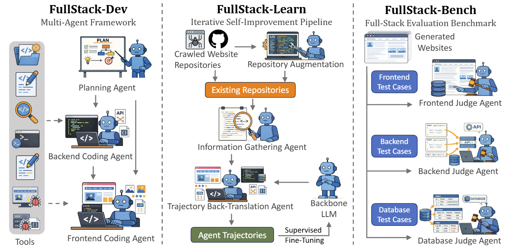
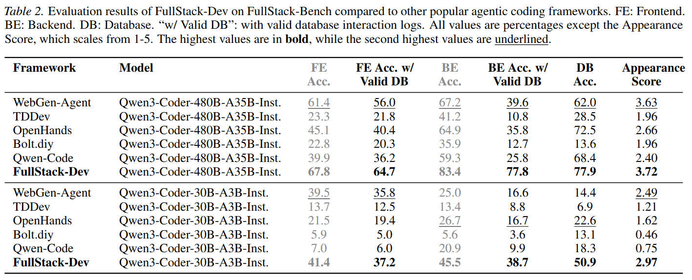
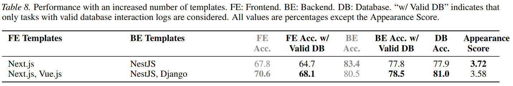
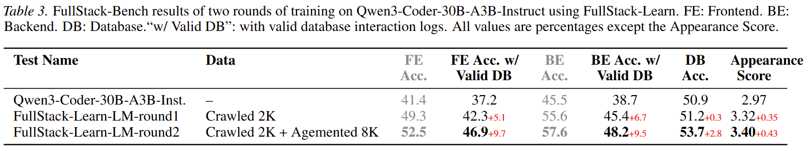

# FullStack-Agent

### Overview

This is the official repository for the paper ["FullStack-Agent: Enhancing Agentic Full-Stack Web Coding via Development-Oriented Testing and Repository Back-Translation"](https://arxiv.org/abs/2602.03798).
In this paper, we introduce **FullStack-Agent**, a unified system that combines a multi-agent full-stack development framework equipped with efficient coding and debugging tools ([FullStack-Dev](https://github.com/mnluzimu/FullStack-Dev)), an iterative self-improvement method that improves the abilities of LLMs through repository augmentation and back-translation ([FullStack-Learn](https://github.com/mnluzimu/FullStack-Learn)), and a full-stack development benchmark that comprehensively evaluates frontend, backend, and database functionalities ([FullStack-Bench](https://github.com/mnluzimu/FullStack-Bench)).



### Quick Start

Instructions for installation and running of the three components are in the following documents:

- [FullStack-Dev](https://github.com/mnluzimu/FullStack-Dev)

- [FullStack-Learn](https://github.com/mnluzimu/FullStack-Learn)

- [FullStack-Bench](https://github.com/mnluzimu/FullStack-Bench)

### Models

| Model Name | Huggingface Link |
|------------|------------------|
| FullStack-Learn-LM-30B-A3B| 🤗 [luzimu/FullStack-Learn-LM-30B-A3B](https://huggingface.co/luzimu/FullStack-Learn-LM-30B-A3B) |


### Dataset

| Dataset Name | Huggingface Link |
|------------|------------------|
| FullStack-Bench | 🤗 [luzimu/FullStack-Bench](https://huggingface.co/datasets/luzimu/FullStack-Bench) |


### Experimental Results

Experimental results of FullStack-Dev on [FullStack-Bench](https://github.com/mnluzimu/FullStack-Bench) compared to popular baseline methods are shown below:



The result of using more templates is presented below:



Using more templates result in better performance in most of the metrics, which might be due to the fact that with more templates to choose from, the agent can find the most appropriate and easy-to-work-with templates, thus making the development process smoother.

Experimental results of FullStack-Learn tested on with FullStack-Dev on FullStack-Bench are as follows:



## Related Works

- **WebGen-Bench**: A benchmark for evaluating LLM-based agents on generating interactive and functional websites from scratch. It contains 101 website-generation instructions, 647 test cases, and a training set of 6,667 instructions named WebGen-Instruct.  
  GitHub: [mnluzimu/WebGen-Bench](https://github.com/mnluzimu/WebGen-Bench)  
  Paper: [WebGen-Bench: Evaluating LLMs on Generating Interactive and Functional Websites from Scratch](https://arxiv.org/abs/2505.03733)

- **WebGen-Agent**: An advanced website generation agent that autonomously creates websites from natural language instructions. It iteratively generates website codebases and refines them using visual and functional feedback, including screenshot-based VLM feedback and GUI-agent feedback.  
  GitHub: [mnluzimu/WebGen-Agent](https://github.com/mnluzimu/WebGen-Agent)  
  Paper: [WebGen-Agent: Enhancing Interactive Website Generation with Multi-Level Feedback and Step-Level Reinforcement Learning](https://arxiv.org/abs/2509.22644)

### Cite
If you find our project helpful, please cite:

```
@misc{lu2026fullstackagentenhancingagenticfullstack,
      title={FullStack-Agent: Enhancing Agentic Full-Stack Web Coding via Development-Oriented Testing and Repository Back-Translation}, 
      author={Zimu Lu and Houxing Ren and Yunqiao Yang and Ke Wang and Zhuofan Zong and Mingjie Zhan and Hongsheng Li},
      year={2026},
      eprint={2602.03798},
      archivePrefix={arXiv},
      primaryClass={cs.SE},
      url={https://arxiv.org/abs/2602.03798}, 
}
@misc{lu2025webgenagentenhancinginteractivewebsite,
      title={WebGen-Agent: Enhancing Interactive Website Generation with Multi-Level Feedback and Step-Level Reinforcement Learning}, 
      author={Zimu Lu and Houxing Ren and Yunqiao Yang and Ke Wang and Zhuofan Zong and Junting Pan and Mingjie Zhan and Hongsheng Li},
      year={2025},
      eprint={2509.22644},
      archivePrefix={arXiv},
      primaryClass={cs.CL},
      url={https://arxiv.org/abs/2509.22644}, 
}

@misc{lu2025webgenbenchevaluatingllmsgenerating,
      title={WebGen-Bench: Evaluating LLMs on Generating Interactive and Functional Websites from Scratch}, 
      author={Zimu Lu and Yunqiao Yang and Houxing Ren and Haotian Hou and Han Xiao and Ke Wang and Weikang Shi and Aojun Zhou and Mingjie Zhan and Hongsheng Li},
      year={2025},
      eprint={2505.03733},
      archivePrefix={arXiv},
      primaryClass={cs.CL},
      url={https://arxiv.org/abs/2505.03733}, 
}
```
